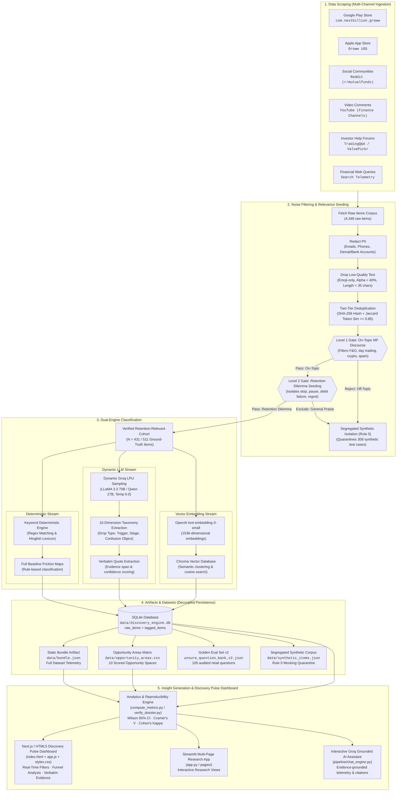

# Groww SIP Retention Discovery Engine
## Architecture & Pipeline Specification

An autonomous, multi-channel empirical research engine and interactive intelligence dashboard engineered for Growth Product Managers and Quantitative UX Researchers at **Groww**.

---

### ⚙️ Pipeline Breakdown

* **Data Scraping:** The pipeline begins by fetching real user feedback across multi-channel public platforms—Google Play Store (`com.nextbillion.groww`), Apple App Store (Groww iOS, ID `1404871703`), targeted Reddit investment communities (`r/mutualfunds`, `r/personalfinanceindia`, `r/IndiaInvestments`, `r/IndianStreetBets`, `r/groww`), YouTube video comments (official Groww mutual fund explainers and personal finance channels like Pranjal Kamra and Akshat Shrivastava), investor help forums (TradingQ&A by Zerodha, ValuePickr, CAMS/KFintech settlement threads), and targeted financial web queries using Python collectors, Apify actors, and Playwright scraper scripts.

* **Noise Filtering & Relevance Seeding:** Before analysis, raw text is aggressively filtered. PII (phone numbers, email addresses, 16-digit demat/bank account numbers, PAN/KYC identifiers) is redacted, low-quality reviews (emoji-only, spam, alpha-character density $<40\%$, reviews $<35$ characters) are dropped, hash-based deduplication (exact SHA-256 hashing and token Jaccard similarity $\ge 0.85$) removes duplicates, and a **Two-Level Relevance Filter** isolates retention-relevant signals:
  * **Level 1 Filter (On-Topic Mutual Fund Discourse):** Discards equity day-trading, F&O derivatives scalping, crypto, and demat maintenance fee noise.
  * **Level 2 Filter (Retention Dilemma Seeding):** Filters out generic UI compliments and isolates actionable drop, pause, failure, or regret signals (*"stop sip"*, *"failed debit"*, *"bounce charge"*, *"negative returns"*, *"xirr wrong"*, *"how to pause"*).
  * **Rule 0 Synthetic Segregation:** Quarantines synthetic test cases into isolated storage (`data/synthetic_items.json`), guaranteeing zero contamination of empirical metrics.

* **Dual-Engine Classification:**
  * **Keyword Deterministic Engine:** Fast, regex-based matching with Hinglish and Hindi vocabulary support that buckets all incoming reviews into baseline friction themes, lifecycle stages, and drop types.
  * **Dynamic LLM Engine:** On-demand Groq LPU API (powered by `qwen/qwen3.8-27b` and `llama-3.3-70b-versatile` / `llama3-70b-8192` with fallback to `openai/gpt-oss-120b`, temperature $0.0$) that classifies reviews into a structured **10-Dimension Research Taxonomy** (`drop_type`, `sip_status`, `trigger`, `lifecycle_stage`, `in_app_confusion_object`, `mandate_subcluster`, `stated_expectation`, `check_frequency`, `outside_app_action`, `disconfirming_pass_attribution`) with verbatim evidence extraction and confidence scores.
  * **Semantic Embeddings & Vector Search:** OpenAI `text-embedding-3-small` (1536 dim) + Chroma vector database for semantic clustering and similarity retrieval.

* **Artifacts & Datasets:** The classified dataset and aggregated metrics are persisted in SQLite (`data/discovery_engine.db`) across normalized tables (`raw_items`, `tagged_items`), as well as static JSON and CSV artifacts (`bundle.json`, `tagged_items.json`, `tagged_items.csv`, `opportunity_areas.csv`, and `unsure_question_bank_v2.json`), enabling a stateless, decoupled backend architecture and high-performance serverless deployments.

* **Insight Generation & UI:** The analytics engine reads active artifacts, calculates Wilson 95% confidence intervals, Cramér's V channel independence scores, and multi-factor opportunity rankings ($\text{Severity} \times \text{Stop Pct} \times \text{Addressability} \times \text{Volume Weight}$) to construct the **10 Defensible Opportunity Spaces** and the **Audited Golden Evaluation Set (105 questions with 35 must-decline guardrails)**. The reactive **Discovery Pulse Dashboard** (`index.html` + `app.js` + `styles.css`) and **Streamlit Multi-Page Research App** surface verbatim user quotes, funnel analytics, and interactive filters, powering an interactive **Groq Grounded AI Insights Assistant** strictly grounded on customer evidence.

---

### 📐 System Architecture Flowchart

---

### 📊 Taxonomy & Opportunity Matrix Summary

| Layer | Implementation Component | Key Function & Technology |
|:---|:---|:---|
| **Data Ingestion** | `collectors/` (`play_store.py`, `app_store.py`, `reddit.py`, `youtube.py`, `help_forum.py`, `web_search.py`, `apify_collector.py`) | Multi-channel balanced scraping across 6 distinct retail investor touchpoints. |
| **Data Hygiene** | `pipeline/normalizer.py`, `pipeline/deduplicator.py` | PII redaction, SHA-256 exact hash deduplication, Jaccard token similarity ($\ge 0.85$), and length/alpha density guards. |
| **Two-Level Filter** | `pipeline/tagger.py` | Level 1: Mutual fund discourse isolation; Level 2: Retention dilemma identification; Rule 0 synthetic segregation. |
| **Deterministic Engine** | `pipeline/tagger.py` (Keyword & Regex Pass) | Rapid rule-based pattern matching with Hinglish/Hindi vocabulary support for baseline friction classification. |
| **Dynamic LLM Engine** | `pipeline/tagger.py` + Groq LPU API | Deep 10-dimension taxonomy extraction using `qwen/qwen3.8-27b` and LLaMA 3.3 70B with verbatim evidence spans. |
| **Vector Search** | `pipeline/embedder.py` + Chroma DB | Cosine semantic clustering via OpenAI `text-embedding-3-small` (1536 dim). |
| **Decoupled Persistence** | SQLite (`discovery_engine.db`) + `data/bundle.json` | Decoupled, serverless-ready storage maintaining immutable empirical ground truth. |
| **Analytics Engine** | `pipeline/compute_metrics.py`, `verify_dossier.py` | Wilson 95% confidence intervals, Cramér's V channel independence ($<0.80$), and multi-factor opportunity scoring. |
| **Discovery Pulse UI** | `index.html`, `app.js`, `styles.css` / `app.py` | Interactive client-side dashboard with dynamic charts, funnel breakdown, and live search. |
| **Grounded AI Assistant** | `pipeline/chat_engine.py` (Groq API) | Verbatim evidence retrieval and prompt-engineered PM synthesis without hallucinations. |

---

### 📄 Executive Deliverables & Publication Assets

* **Downloadable 2-Page Executive PDF:** [`Groww_AI_Discovery_Engine_Architecture.pdf`](file:///Users/tanishq/Desktop/NextLeap/google_Scapper/Groww_AI_Discovery_Engine_Architecture.pdf)
* **HTML Print Source Template:** [`Groww_AI_Discovery_Engine_Architecture.html`](file:///Users/tanishq/Desktop/NextLeap/google_Scapper/Groww_AI_Discovery_Engine_Architecture.html)
* **High-Resolution Vector Diagram:** [`architecture_diagram.svg`](file:///Users/tanishq/Desktop/NextLeap/google_Scapper/architecture_diagram.svg)

